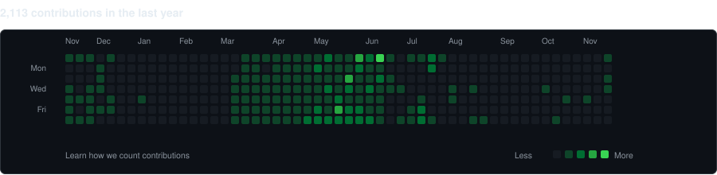
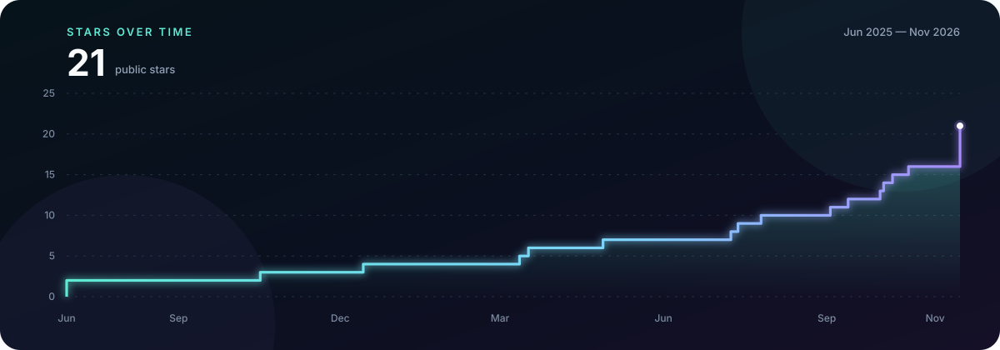
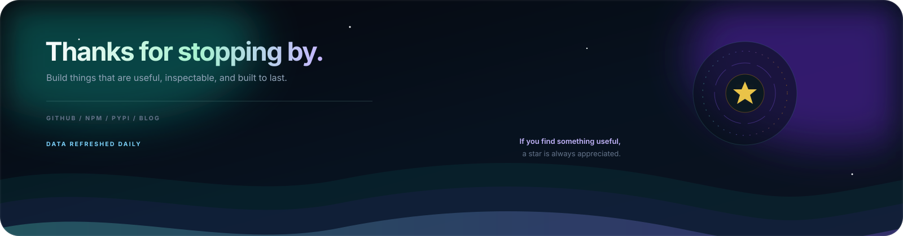

  

  
  
  
  
  

  
  

## Hi, I'm GuoFan

I build practical AI systems across **medical imaging**, **agentic tooling**, and **local-first knowledge workflows**. I care about work that goes beyond the demo: reproducible research code, tools that fit real workflows, and interfaces that make complex systems easier to understand.

我关注医学影像、AI 智能体与本地优先的知识工作流，喜欢把复杂能力做成真正可用、可检查、可复现的产品。

## 01 · Live signal

  

  

  Star history is refreshed every day by GitHub Actions.

## 02 · Packages

  
  
  
  

Top five by downloads in the last 30 days:

| Package | Version | 30-day | All-time |
| :--- | :--- | ---: | ---: |
| **[dsh-budget-view](https://github.com/SuShuheng/dsh-budget-view)** Codex / DeepSeek budget and cost visibility |  |  |  |
| **[dsh-thinking-effort-slide-bar](https://github.com/SuShuheng/dsh-thinking-effort-slide-bar)** Reasoning-effort slider for DeepSeek Harness |  |  |  |
| **[dsh-windows-acl-logon-dacl-fix](https://github.com/SuShuheng/dsh-windows-acl-logon-dacl-fix)** Windows ACL and logon DACL repair for DSH |  |  |  |
| **[se-cli](https://pypi.org/project/se-cli/)** Medical image segmentation evaluation CLI |  |  |  |
| **[dglz](https://pypi.org/project/DGLZ/)** EEG emotion recognition with CNN-Transformer encoders |  |  |  |

Also published: `nrdp-cli`, `btvit-cli`, `jwztumor`, `btsp-cli`, `eip-cli`, `obshare-cli`. PyPI totals count direct PyPI downloads; mirror traffic is excluded.

## 03 · Currently building

- **[PyMentor-Lab](https://github.com/SuShuheng/PyMentor-Lab)** — a higher-education Python learning system with deterministic mastery engines and a six-node LangGraph agent.
- **[MyPage](https://github.com/SuShuheng/MyPage)** — a DIY, local-first Obsidian homepage with widgets, themes, and a plugin marketplace.
- **[making-things](https://github.com/SuShuheng/making-things)** — an evidence-gated AI coding workflow for Codex, ZCode, and Claude Code.
- **[dsh-budget-view](https://github.com/SuShuheng/dsh-budget-view)** — Codex and DeepSeek usage, balance, and cost visibility for real-time budget awareness.

## 04 · Selected work

| Project | What it is | Stack |
| :--- | :--- | :--- |
| **[MyPage](https://github.com/SuShuheng/MyPage)** | A customizable Obsidian dashboard with a widget system, theme marketplace, and local-first data model. | TypeScript · Preact · GridStack |
| **[PyMentor-Lab](https://github.com/SuShuheng/PyMentor-Lab)** | A full-stack learning system exploring deterministic mastery engines and a multi-node AI agent for higher education. | Python · FastAPI · LangGraph · React |
| **[comfyui-t2v-movies-workflow](https://github.com/SuShuheng/comfyui-t2v-movies-workflow)** | A fully automated text-to-movie pipeline: LLM screenplay, storyboard, Z-Image frames, Wan 2.2 clips, and FFmpeg assembly. | Python · ComfyUI · Wan 2.2 |
| **[making-things](https://github.com/SuShuheng/making-things)** | An Electron-based AI coding workflow that keeps the lifecycle from PRD to release persisted and evidence-gated. | Electron · TypeScript · AI agents |

## 05 · Toolbox

  
  
  
  
  
  
  
  
  

## 06 · How I work

- **Useful over impressive** — a smaller tool that fits a real workflow beats a demo that only looks good.
- **Reproducible by default** — research code and data pipelines should be easy to inspect, rerun, and trust.
- **Local-first when possible** — I prefer tools that keep people in control of their data.

## 07 · Writing & contact

I write about the things I build and learn at **[博客天地](https://blogs-world.sushuheng.top)** — notes on programming, life, and practical engineering.

  
  
  
  

  

