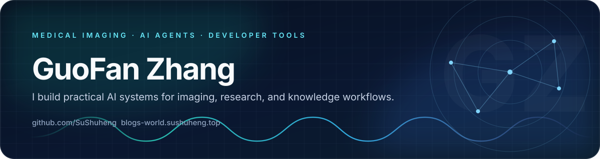

  

  
  
  

### Hi, I'm GuoFan 👋

I build practical AI systems across **medical imaging**, **agentic tooling**, and **local-first knowledge workflows**.

I care about work that goes beyond the demo: reproducible research code, tools that fit real workflows, and interfaces that make complex systems easier to understand.

> 我关注医学影像、AI 智能体与本地优先的知识工作流，喜欢把复杂能力做成真正可用的产品。

---

## Currently building

- **[PyMentor-Lab](https://github.com/SuShuheng/PyMentor-Lab)** — a higher-education Python learning system with deterministic mastery engines and a six-node LangGraph agent.
- **[MyPage](https://github.com/SuShuheng/MyPage)** — a DIY, local-first Obsidian homepage with widgets, themes, and a plugin marketplace.
- **[making-things](https://github.com/SuShuheng/making-things)** — an evidence-gated AI coding workflow for Codex, ZCode, and Claude Code.
- **[dsh-budget-view](https://github.com/SuShuheng/dsh-budget-view)** — Codex and DeepSeek usage, balance, and cost visibility for real-time budget awareness.

## Selected work

| Project | What it is | Stack |
| :--- | :--- | :--- |
| **[MyPage](https://github.com/SuShuheng/MyPage)** | A customizable Obsidian dashboard with a widget system, theme marketplace, and local-first data model. | TypeScript · Preact · GridStack |
| **[PyMentor-Lab](https://github.com/SuShuheng/PyMentor-Lab)** | A full-stack learning system exploring deterministic mastery engines and a multi-node AI agent for higher education. | Python · FastAPI · LangGraph · React |
| **[comfyui-t2v-movies-workflow](https://github.com/SuShuheng/comfyui-t2v-movies-workflow)** | A fully automated text-to-movie pipeline: LLM screenplay, storyboard, Z-Image frames, Wan 2.2 clips, and FFmpeg assembly. | Python · ComfyUI · Wan 2.2 |
| **[making-things](https://github.com/SuShuheng/making-things)** | An Electron-based AI coding workflow that keeps the lifecycle from PRD to release persisted and evidence-gated. | Electron · TypeScript · AI agents |

## Toolbox

  
  
  
  
  
  
  
  
  

## How I work

- **Useful over impressive** — a smaller tool that fits a real workflow beats a demo that only looks good.
- **Reproducible by default** — research code and data pipelines should be easy to inspect, rerun, and trust.
- **Local-first when possible** — I prefer tools that keep people in control of their data.

## Writing

I write about the things I build and learn at **[博客天地](https://blogs-world.sushuheng.top)** — notes on programming, life, and practical engineering.

## Connect

  
  
  

---

  Build things that are useful, inspectable, and built to last.

